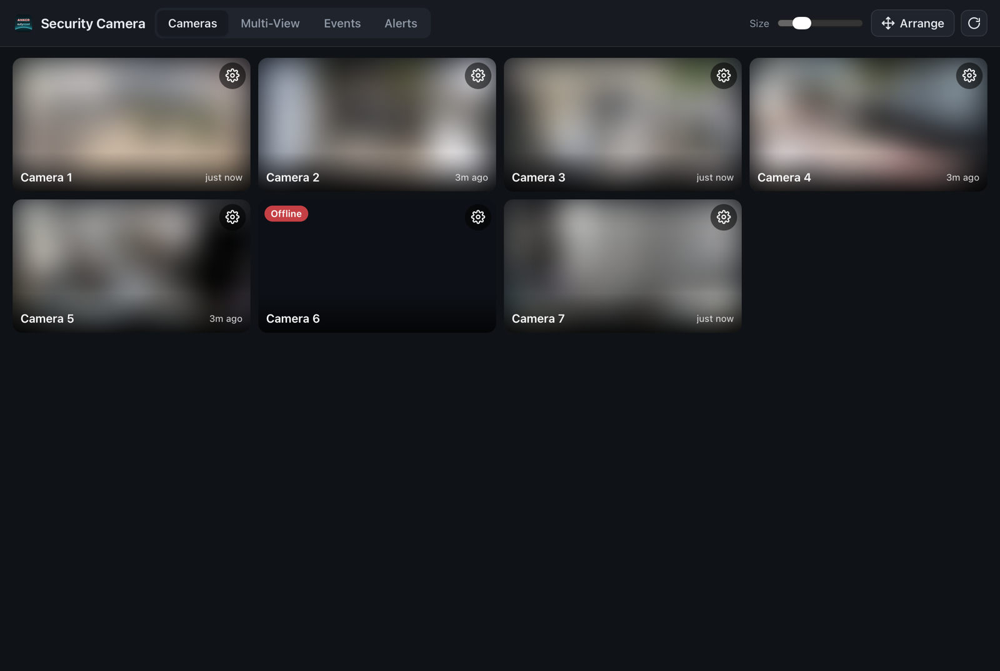
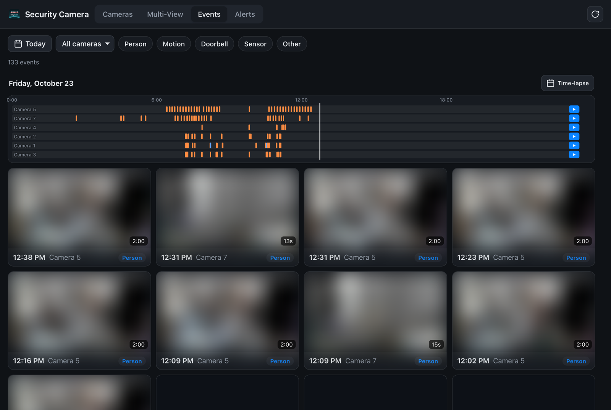
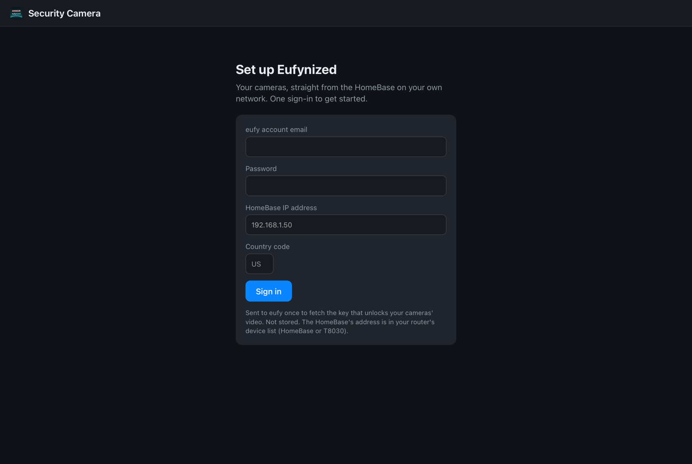
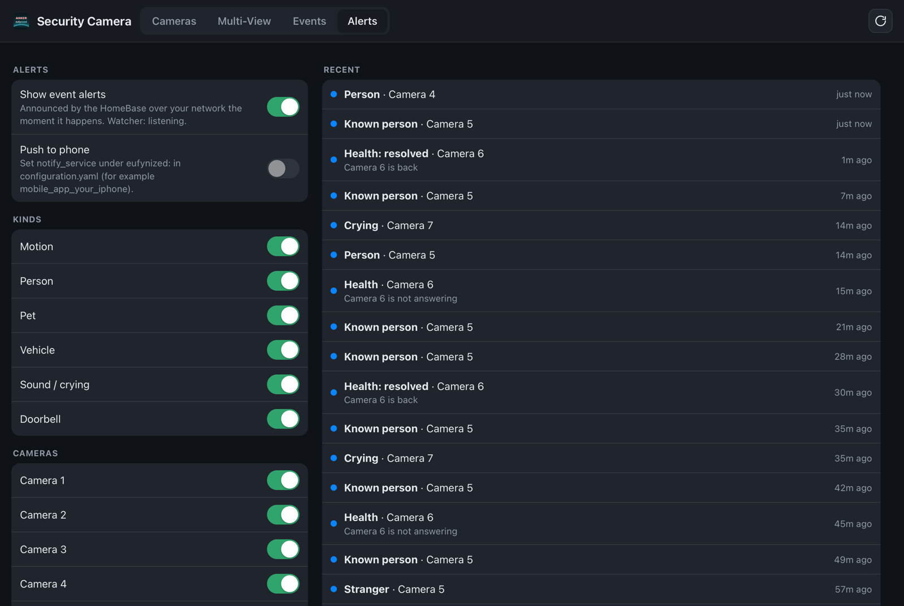

# Eufynized bridge

Eufy cameras in Home Assistant straight from the HomeBase 3 over your own network: live video, recordings,
settings, detection sensors, alarm panel. No Eufy cloud in the video path, no RTSP, no go2rtc to configure.

This is the free, open part of Eufynized: a bridge that runs next to Home Assistant, a Home Assistant
integration, the Swift library that speaks the HomeBase's local P2P protocol, and the research behind it.
The Mac app is separate: see [rkoh46/eufynized-app](https://github.com/rkoh46/eufynized-app) for what it
does and to report bugs or request features for it. Issues with the bridge or the integration go in this
repo's [Issues](../../issues).



## What you get

- **A "Security Camera" panel in the sidebar:** live view, Multi-View (how many at once is up to you),
  events timeline with Photos-style scrubbing, pan-tilt with saved positions and panorama, quick replies
  through the camera speaker, activity zones drawn on the picture, every camera setting the eufy app offers.
- **Entities:** `camera.*` (snapshot and stream), person / motion / pet / vehicle / sound binary sensors,
  the latest event picture, an alarm panel for guard mode, switches and selects for camera settings
  (including Direct power and continuous recording on the S3 Pro), battery / signal / storage sensors.
- **`eufynized_event`** on the event bus for your automations, with the event's picture.
- **Alerts:** health (offline, low battery, weak link, full drive), loitering, a morning digest, quiet hours,
  snooze, and phone pushes with View live / Snooze / False alarm buttons.
- **One HomeBase session per camera**, shared by every screen in the house. The HomeBase only allows a few.



Tested with HomeBase 3, eufyCam S3 Pro, eufyCam 2C, SoloCam S340, Indoor Cam E30.

## How it works

```
Cameras ──► HomeBase 3 ──(local P2P, your LAN)──► eufynized-bridge :18099 ──► Home Assistant
```

The HomeBase encrypts video with a key that only eufy's cloud hands out. The bridge fetches it once, when you
sign in on its page the first time; after that nothing talks to the cloud. The key lives in `bridge.json`
next to the bridge.

## Install

### What you need

- A **HomeBase 3** with a fixed IP address on your network (set it in your router).
- **Home Assistant Core running in Docker Compose** on a Linux box (a Raspberry Pi 4 or 5 is fine), with the
  config in `/opt/ha/config` and `docker-compose.yml` in `/opt/ha`. SSH into it with passwordless `sudo`.
  Running Home Assistant OS instead? See [Home Assistant OS](#home-assistant-os) below.
- Any computer with `ssh`, `rsync` and `git` to run the installer from (Mac or Linux). The bridge is
  compiled on the box itself, inside Docker, so nothing else is needed.
- Your **eufy account** email and password, and the 2FA code eufy sends.

### 1. Install the bridge and the integration

```bash
git clone https://github.com/rkoh46/eufynized-bridge.git && cd eufynized-bridge
scripts/install-ha.sh pi@192.168.1.60
```

It compiles the bridge on the box (10–20 minutes the first time on a Pi, a minute after that), adds an
`eufynized` service to `/opt/ha/docker-compose.yml` (host network, data in `/opt/ha/eufynized/data`), copies
the integration into `/opt/ha/config/custom_components/eufynized`, adds `eufynized:` to `configuration.yaml`,
and restarts Home Assistant Core if the integration changed. It backs up both files first
(`*.bak-<date>-eufynized`).

### 2. Sign in once

Open `http://<box>:18099` (or **Security Camera** in Home Assistant's sidebar). The first time, the page asks
for your eufy email and password, the HomeBase's IP address, and your country code. Captcha and the 2FA code
follow if eufy asks for them.



The bridge signs in, reads the HomeBase's cipher id over your network, fetches the key that unlocks the video
and the list of your cameras, saves them to `/opt/ha/eufynized/data/eufynized/bridge.json`, and restarts.
The password and the cloud session are not kept; after this nothing talks to eufy's cloud.

**Back up `bridge.json`.** It holds the key, the one thing you can't get back without signing in again.

### 3. Look

**Security Camera** is in the sidebar; the cameras and sensors are under Settings → Devices & services →
Entities (search `eufynized`).

### Configuration (optional)

In `configuration.yaml`:

```yaml
eufynized:
  url: http://127.0.0.1:18099          # where the bridge is (default)
  notify_service: mobile_app_your_phone # pushes with View live / Snooze / False alarm buttons
  entity_names:                         # keep entity ids from a previous integration
    T8162T0000000001: backyard
  alarm_entity_name: eufy_home_base     # default: eufynized_home_base
  sidebar_title: Security Camera
```

Alerts (quiet hours, per-camera windows, loitering, morning digest, which cameras and kinds) are set in the
panel's **Alerts** tab and stored by the bridge.



### Updating

```bash
git pull
scripts/install-ha.sh pi@192.168.1.60
```

### Signing in again

A new camera, or a different eufy account: `POST http://<box>:18099/api/setup/login` with the same fields the
page uses, or delete `bridge.json` and restart the service to get the sign-in page back. (A button for this is
coming.)

### Without the page: the key from a Mac

If you'd rather not type the password into the page, the same key step runs on a Mac with Xcode's Command Line
Tools: `swift run eufynized-login you@example.com`, then
`swift run eufynized-cipher you@example.com T8030XXXXXXXXXXX 192.168.1.50`, then
`HOMEBASE_IP=… STATION_SERIAL=… EUFY_EMAIL=… scripts/export-ha-config.sh --install pi@<box>` writes the same
`bridge.json`.

### Home Assistant OS

`ha-addon/` is a Supervisor add-on (ingress panel, host network, options `homebase_ip` and
`notify_service`). It needs the bridge binary, which `scripts/build-ha-addon.sh` builds in Docker; copy the
`ha-addon/eufynized` folder to `/addons` on the HA OS host, install it from the add-on store's local section,
start it, and sign in on its page. Also copy `ha-integration/custom_components/eufynized` into `/config`.
This path is not what the author runs, so expect to adjust; issues welcome.

## Files on the box

| Path | What |
|---|---|
| `/opt/ha/eufynized/app/` | bridge binary, web page, Dockerfile |
| `/opt/ha/eufynized/data/eufynized/bridge.json` | the key, HomeBase address, camera list |
| `/opt/ha/eufynized/data/eufynized/prefs.json` | quality, snooze, presets, quiet hours, digest time |
| `/opt/ha/eufynized/data/eufynized/replies/` | quick-reply audio |
| `/opt/ha/config/custom_components/eufynized/` | the integration |

Back up `bridge.json` and `prefs.json`. Everything else comes from this repo.

## Troubleshooting

- **"No video from this camera" on every tile:** the HomeBase has run out of sessions (it serves only a
  few at once). Close other viewers, or pick a smaller Multi-View layout.
- **On a TV's browser (LG webOS and the like):** one camera plays, a wall of them doesn't; the TV has one
  hardware decoder and little memory. Use the Cameras tab there and open one camera at a time.
- **A camera's picture stops for a few seconds at a time:** a camera sends to one session at a time, so
  anything else that opens its own session to the HomeBase (the Mac app's Multi-View, the eufy app) takes the
  picture away. The bridge asks for it back after 10 s, waiting longer each time it happens again, so the two
  don't fight all day. Watch through the bridge from everywhere and it never happens.
- **Video arrives in bursts:** the box is on Wi-Fi. Ethernet fixes it.
- **Cameras start at 720p:** they all do, then ramp up on their own after a few seconds.
- **A camera shows the HomeBase's "active" camera instead of itself:** the key or account id in
  `bridge.json` is wrong. Delete the file, restart the service, sign in again.
- **The sign-in page says the HomeBase didn't answer:** wrong IP, or the box isn't on the same network as the
  HomeBase (the bridge must run with host networking, which the installer sets).
- **Bridge refuses the Mac app or another device:** `EUFYNIZED_ALLOW_FROM=192.168.1.` in the compose
  service lists the address prefixes allowed in. The bridge has no login of its own, so keep it on the LAN or
  behind a private tunnel.
- **Logs:** `docker logs -f eufynized` on the box.

## Development

```bash
swift build
scripts/test.sh
swift run eufynized-fps <serial> <channel> <homebase-ip> <email>   # measure a direct stream
swift run eufynized-fps --bridge http://<box>:18099 <channel>      # measure the bridge feed
swift run eufynized-probe …                                        # send a command (allow-listed, read-only)
```

Targets: `EufyKit` (the protocol: P2P transport, level-2 per-camera selection, settings catalog, recordings),
`EufynizedKit` (bridge client, live stream plumbing), `eufynized-bridge` (the HTTP/WebSocket server), and
command-line tools for login, discovery, snapshots, PTZ, settings and health.

Protocol research (command tables, what the HomeBase sends, what was verified) is in
[`docs/homebase-research/`](docs/homebase-research/README.md).

## Disclaimer

Not affiliated with Anker or Eufy. "Eufy" is a trademark of Anker Innovations. Transport code is ported from
[eufy-sdk](https://github.com/mega-yfue/eufy-sdk) (Apache-2.0), informed by
[eufy-security-client](https://github.com/bropat/eufy-security-client) (MIT). No code or assets from Eufy's
apps. Firmware updates can change the protocol at any time.

## License

MIT
